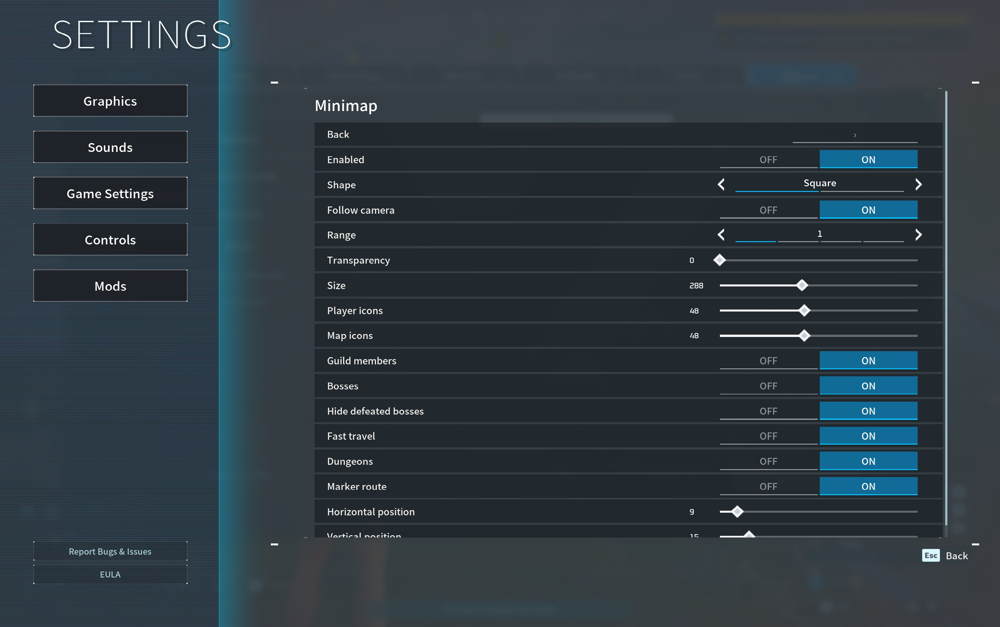

# Palworld Minimap

A configurable in-game map for [Palworld Mods](https://github.com/lansbe/palworld-mods),
with camera follow, nearby guild members and points of interest.

**[Get the Mac app](https://github.com/lansbe/palworld-mods/releases/latest)** ·
[Installation](#install-no-terminal-needed) · [Settings](#make-it-yours) ·
[Contributing](CONTRIBUTING.md)

*Actual gameplay, with the square map and camera follow enabled.*

## Install: no Terminal needed

Minimap comes **installed and enabled with Palworld Mods**. You do not need to
download this repository, copy Lua files or install its release JSON manually.

1. Quit Palworld. Download the **-macos-arm64.dmg** file under **Assets** on the
   [Palworld Mods release page](https://github.com/lansbe/palworld-mods/releases/latest).
2. Open it, **drag Palworld Mods into Applications**, then eject the disk image.
3. Open **Palworld Mods** from Applications and load a world.
4. Close the menus. The map appears in the upper-left corner. Open
   **Options → Mods → Minimap** to adjust it.

Already using Palworld Mods? Go straight to step 4. If you previously removed
Minimap, open **Options → Mods → Manage mods** and select its gray entry to
reinstall it. No game restart is needed.

Requires Apple silicon, macOS 14+, the supported Mac App Store game (app 1.0.8,
build 102999), and Palworld Mods 0.3.0 or newer. Use the latest app for fixes.
For macOS first-launch approval, see the [app installation guide](https://github.com/lansbe/palworld-mods#install-in-five-steps).

## Make it yours

*Settings apply in the game and are remembered between sessions.*

| Setting | What it changes |
| --- | --- |
| **Enabled** | Show or hide Minimap without uninstalling it. |
| **Shape** | Choose a square or round map. |
| **Follow camera** | Rotate the map toward the direction you are looking. |
| **Range** | Choose 1, 2, 4 or 8. Higher values show more distant terrain. |
| **Transparency / Size** | Adjust the background and overall map size. |
| **Player icons / Map icons** | Make player and point-of-interest markers easier to see. |
| **Guild members** | Show nearby guild members inside the visible map area, without name labels. |
| **Bosses / Fast travel / Dungeons** | Toggle these marker categories independently. |
| **Hide defeated bosses** | Enabled by default. When disabled, progress uses different icons. |
| **Marker route** | Show a route to a marker placed on the game's full map, where navigation data is available. |
| **Horizontal / Vertical position** | Move the map on screen. Scroll down for the final setting. |

Fast-travel icons also distinguish unlocked and undiscovered points. The map
uses the licensed game's terrain textures and follows your position while mounted.
It hides during loading and returns when gameplay is ready.

## Common questions

**Why can't I see my friend?** Enable Guild members. Your friend must be inside
the visible map area, in the same relevant surface/world, and known to your game
client. The mod cannot display information the host has not replicated.

**Why is there no route to a distant marker?** Routes depend on the game's
available navigation data. They cannot cross unloaded or unavailable regions.

**Does it show a complete dungeon floor plan?** This release supports dungeon
trails, not a complete map of every room and wall.

**Where is the map?** Load a world, finish loading, close the menus and check
Enabled. If the Mods category itself is missing, launch **Palworld Mods** from
Applications rather than the original game app.

**How do I remove it?** Use **Options → Mods → Manage mods → Minimap**.
Installation, removal and settings changes do not require a restart.

**How do I change the language?** Use **Options → Mods → Language**. Automatic
follows the game; a manual choice is remembered. All 17 Palworld locales are included.

## Build or contribute

This repository contains the original Lua modules and manifest. The sibling
palworld-mods repository bundles them into its offline mod catalogue. Game
textures are resolved at runtime and are not distributed here.

    python3 scripts/verify.py
    lua tests/geometry.lua

See [CONTRIBUTING.md](CONTRIBUTING.md) for setup and review guidelines. CPU work
is sampled and cached, but cold asset loading or widget creation can still cause
isolated frame-time spikes. Screenshots do not establish a performance benchmark.
New features must include all translations and follow the shared
[localization contract](https://github.com/lansbe/palworld-mods/blob/master/docs/localization.md).

## License

Original code is [MIT-licensed](LICENSE). This is an independent community project,
not an official Pocketpair product. Palworld and the game content shown in the
[real screenshots](docs/screenshots/README.md) belong to their respective owners.
